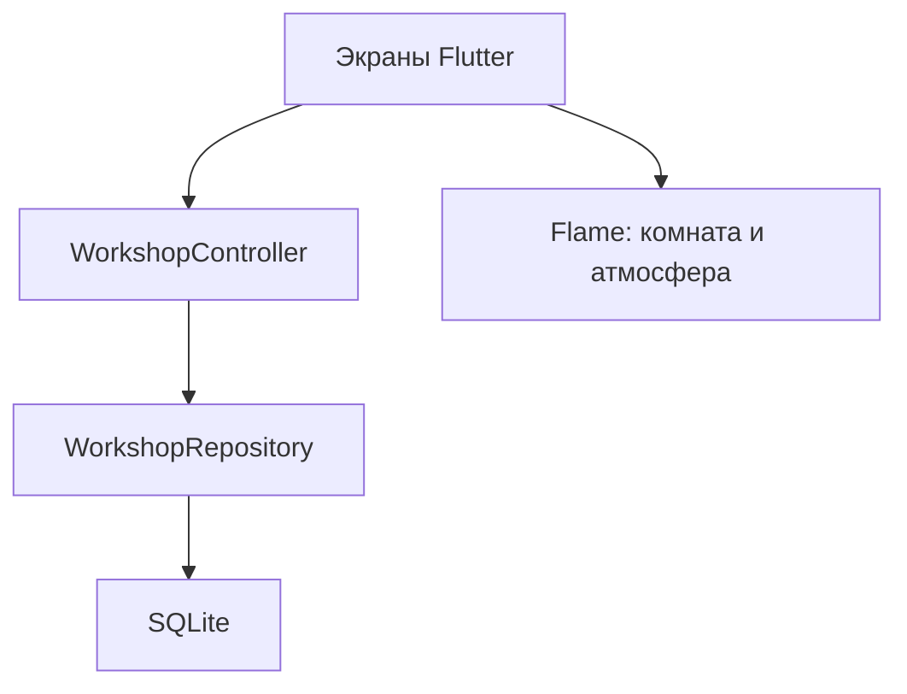

## Изменения представления в v0.2.1, сборка 5

`WorkshopHeader` владеет верхним системным inset; нижним — `WorkshopNavigation`. `ShopLayout` измеряет карточку проекта первым проходом и отдаёт оставшуюся высоту `WorkshopSceneView`. На коротком экране весь блок прокручивается, минимальная сцена сохраняет доступность предметов.

`RoomViewport` вычисляет общую геометрию для Flame и Flutter hit targets: логическая ширина 384, высота 368–500, единый масштаб. Верхние объекты остаются у окна и полок; нижняя мебель сдвигается по высоте; стол/лампа/кружка перемещаются согласованно. Текстура пола повторяется отдельным компонентом. Размеры и пропорции каждого исходного спрайта сохраняются. Существующие свет и пар следуют за лампой и кружкой.

`WorkshopType` хранит именованные стили. Шрифты и все нужные веса локальны. Репозиторий, контроллер, модель проекта и schema_v1.sql не менялись.

---

# Лавка забытых историй · архитектура 0.1.1

> Обновление v0.2: рабочая архитектура проектов, счётчиков и SQLite из этого документа сохранена. Описание старой графики 216×240 и четырёх слоёв ниже относится к первому срезу. Актуальная комната 384×432, её объекты, маршруты, эффекты и проверки описаны в [STAGE_02_RU.md](STAGE_02_RU.md), ресурсы — в [ASSETS_V02.md](ASSETS_V02.md).

Исходник: ТЗ v1.0 от 10.11.2026 и приложенный визуальный референс. Целевая платформа — Android, портрет. Этот документ фиксирует решения первого среза, а не изменение всего продуктового ТЗ.

## Вывод по ТЗ

Продукт состоит из двух связанных контуров: надёжный офлайн-инструмент вязания и атмосферная лавка. Инструмент должен работать самостоятельно. Сеть, кадровая частота Flame и сюжет не имеют права блокировать сохранение. Главный технический критерий — не красота картинки, а цепочка «создать → посчитать → переключить → закрыть → восстановить».

Объём полного MVP велик: библиотека документов, сохранение позиции просмотра, погода с часовыми поясами, журнал работы, сюжет, награды, декор и резервное копирование. Все эти части нельзя считать готовыми по наличию кнопок на главной иллюстрации.

Референс задаёт композицию и палитру, но содержит печатный текст, кнопки и смешивает несколько графических слоёв. Он не используется как фон приложения. В срезе созданы оригинальные упрощённые пиксельные ресурсы. По художественной детализации это технический арт, который ещё требует отдельного прохода художника. Стиль сохраняет дерево, янтарь, пергамент, сливовую пряжу, прохладную гавань, кресло, стол, кота и сундук.

## Архитектура

Flutter отвечает за формы, навигацию, доступность, счётчик, системный выбор файлов и просмотр документов. Flame отвечает за комнату, спрайты, свет и атмосферу. `GameWidget` встраивает сцену в дерево Flutter; это соответствует официальной модели интеграции движка: https://docs.flame-engine.org/latest/flame/game_widget.html.



Сцена не имеет ссылки на БД. Предметы передают только намерения навигации через Flutter-зоны с семантическими подписями. Для стола и корзины существуют альтернативные переходы через нижнее меню. Письма и сундук сейчас декорации без фиктивных интерактивных меток.

### Почему этот стек

- Flutter stable 3.47.9 / Dart 3.13.7 — установленная и использованная для проверок версия.
- Flame 1.38.2 — зафиксированная стабильная версия, без перехода на предварительную 2.0.
- sqflite 2.4.6 — локальная SQLite, транзакции, версионирование схемы; на Android использует системную SQLite.
- sqflite_common_ffi 2.4.6 — только тестовая зависимость: проверяет реальную SQLite вместо имитации словарём.
- ChangeNotifier и конструкторное внедрение зависимостей — достаточно для среза. Riverpod/BLoC имеет смысл оценить при появлении нескольких асинхронных источников, но сейчас ещё один фреймворк не решает дополнительной задачи.
- Прямой SQL вместо ORM: маленькая схема без генерации кода. Перед расширением библиотеки документов стоит повторно оценить Drift. Репозиторий изолирует выбор библиотеки от UI.

Версии прямых зависимостей закреплены в `pubspec.yaml`, транзитивных — в `pubspec.lock`. Проверены страницы издателей: https://pub.dev/packages/flame, https://pub.dev/packages/sqflite, https://pub.dev/packages/sqflite_common_ffi. Обновления требуют повторения тестов и Android-сборки, а не только замены номеров.

### Структура

```text
lib/
  main.dart                         загрузка БД, обработка ошибки открытия
  app/
    workshop_app.dart               оболочка, вкладки, настройки атмосферы
    workshop_controller.dart        очередь команд, снимок подтверждённых данных
    theme.dart                      пергамент, дерево, типографика
  core/storage/
    workshop_repository.dart        транзакции, запросы, версия схемы
  features/
    projects/
      project.dart                  модели и стабильные ID иконок
      create_project_page.dart      реальная форма
      project_icon.dart             пиксельный ресурс и цвет подложки
    counter/counter_panel.dart      общий счётчик для лавки и рабочего режима
    workshop_scene/workshop_game.dart  слои Flame, дождь
assets/
  data/schema_v1.sql
  fonts/                            PT Sans, Press Start 2P и OFL
  images/room/                      четыре RGBA-слоя 216×240
  images/icons/                     шестнадцать RGBA-иконок 24×24
test/
  repository_test.dart              сохранность, статистика, транзакции, очередь
  ui_test.dart                      форма, навигация, адаптивность, рендер
integration_test/
  persistence_test.dart             проверка с Android-плагином, отдельная тестовая БД
tools/generate_art.py               воспроизводимые оригинальные пиксельные ресурсы
docs/
  ARCHITECTURE_RU.md
  STAGE_01_RU.md
  screenshots/                      рендеры работающих Flutter-виджетов в тестовой среде
```

Будущие модули добавляются по потребности: `patterns`, `weather`, `mail_story`, `rewards`, `settings`, `storage_backup`. Не создаём десятки пустых сервисов заранее. Настройки текущего среза принадлежат оболочке; при расширении будут выделены.

## Локальные данные и правила записи

SQLite-файл `lavka.sqlite` лежит в приватном каталоге БД приложения. Сохраняется между обычными закрытиями и перезапусками. Удаление приложения/его данных может удалить БД; перенос на другое устройство пока не реализован. Это надо закрыть резервным копированием до регулярного использования как единственного трекера.

| Таблица | Состав и назначение |
|---|---|
| projects | ID, название 1–80 символов, категория, техника, icon_id, palette, статус, даты UTC |
| counters | Один счётчик на проект, current_row ≥ 0, nullable repeat_length, updated_at |
| row_events | ID, project_id, UTC-время, календарный день устройства, delta, work_delta, before_row, after_row, reason, undo_of |
| settings | Одна строка: active_project_id, reduced_motion, haptics |

Внешние ключи включены. Журнал неизменяемый на уровне публичных методов репозитория: исправления добавляют события. `undo_of` уникален, чтобы одну запись нельзя было отменить дважды. Проверки SQL запрещают отрицательные номера и несогласованные before/after.

Создание проекта, создание его счётчика и выбор активного проекта выполняются одной транзакцией. Нажатие счётчика — прочитать текущий ряд → добавить событие → изменить счётчик и дату проекта → commit. Успешное значение отображается после commit. Никакой записи «при выходе», отложенного debounce или SharedPreferences для рядов нет. Режим WAL + `synchronous=FULL` выбран в пользу надёжности; реальные задержки ещё необходимо замерить на телефоне.

Команды контроллера сериализованы. Идентификатор проекта захватывается при нажатии: если сразу переключить работу, уже отправленные команды продолжат относиться к исходной. При ошибке виден баннер, операция не автоматически повторяется и счётчик не оптимистически увеличивается. Кнопка в баннере перечитывает подтверждённые данные, не повторяет ряд: это предотвращает незаметное двойное начисление.

### Терминология и статистика среза

| Действие | Текущий ряд | Выполненная работа |
|---|---:|---:|
| +1 ряд | +1 | +1 |
| −1 / распустить | −1, минимум 0 | 0 изменений |
| Отменить +1 | −1 | −1 на исходную дату |
| Отменить распускание | +1 | 0 изменений |

«Сегодня» и «Всего связано» — **по всем проектам**, что явно объяснено в рабочем режиме. Первая величина — сумма `work_delta` исходного локального дня, вторая — сумма за всю историю. Распускание не стирает уже сделанную работу. Повторное провязывание считается работой. Это рабочее правило прототипа; до игровых наград его необходимо проверить с пользователем и отдельно определить допустимое начисление.

Отмена доступна для последнего ещё не отменённого действия активного проекта и сохраняется в БД. Несколько отмен последовательно раскручивают журнал. Отмена исправления не реализована (redo нет). При смене календарного дня отмена ошибочного нажатия корректирует исходный день, а не создаёт отрицательную работу сегодня.

Дата берётся с устройства, независимо от города в погоде. Исторический `local_day` не пересчитывается после поездки или смены часового пояса. Системные часы не являются защищённым источником времени; античит для личного трекера не нужен. UTC хранится отдельно. При возвращении приложения на передний план статистика перечитывается. Пока приложение остаётся открытым ровно в полночь, «Сегодня» обновится после следующего действия/перечитывания; автоматический таймер — будущая небольшая задача.

### Эволюция схемы

Сейчас версия 1. Для каждого следующего изменения нужен последовательный шаг `vN → vN+1` в `onUpgrade`, тест на существующем заполненном файле и тест повторного открытия. Неподдержанная миграция завершится ошибкой без сброса данных. `repeat_length` зарезервирован, но UI раппорта намеренно не выдаётся за готовую возможность.

Дальнейшие таблицы:

| Модуль | Данные |
|---|---|
| Схемы | patterns, project_patterns, attachments; копии файлов внутри приложения, а не только временные внешние URI |
| Истории | NPC, letter_definitions, letter_unlocks, reading_state; стабильные ID и версия контента |
| Награды | reward_definitions, reward_grants с уникальным source_event/threshold, inventory, room_placements |
| Погода | city_id, IANA timezone, weather_cache, fetched_at UTC, provider, data_version |
| Резервные копии | manifest.json, schema_version, content_version, checksums, JSON-сущности и вложения |

Журнал наград не следует вычислять из текущего ряда. Уже прочитанные письма не отзываются при распускании. Для отмены ошибочного +1 до выдачи награды понадобится правило подтверждения; сейчас пороги не закреплены.

Импорт резервной копии: проверить версию, контрольные суммы, число/размер файлов, пути без `../`, ссылки между сущностями → восстановить во временное хранилище → проверить → атомарно заменить после подтверждения. Копировать только главный SQLite-файл при активном WAL нельзя: нужен согласованный снимок или логический экспорт. Удаление исходной БД перед успешной валидацией запрещено.

## Графика и сцена

`ASSET`-контракт среза:

- Единая логическая сетка комнаты 216×240; четыре PNG одинакового размера с прозрачностью и общим началом координат.
- Z-порядок: `structure` → `harbor` → `interior` → `furniture` → дождь, ограниченный стеклом окна.
- Палитра зафиксирована в `tools/generate_art.py`. Никаких сглаженных фотографий, псевдопикселизации или чужих игровых спрайтов.
- Иконки 24×24, прозрачные, единая обводка и палитра; цвет подложки задаётся UI. Название файла = стабильный icon_id, не индекс в массиве.
- `FilterQuality.none`, без размытия. Flame использует фиксированную логическую камеру, на высоких/коротких экранах — вписывание с полями. На финальных устройствах проверить дробный масштаб и предпочесть кратные физические масштабы там, где это не уменьшает удобство.
- Flutter-зоны стола и корзины вычисляются тем же масштабом и смещением, что камера. Минимальная высота 48 логических пикселей. Счётчик — отдельная настоящая Flutter-панель.
- Дождь — процедурный декоративный эффект, а не данные погодного API. Уменьшение движения замораживает фазу дождя. На другой вкладке/в фоне движок приостанавливается. При уменьшении движения игровой цикл пока остаётся активен для корректного монтирования компонентов; оптимизировать его остановку только после отдельной проверки жизненного цикла.
- Кот, сундук и почтовый ящик в этом этапе статичны. Кружка не обещает анимацию пара.
- Press Start 2P — короткие пиксельные заголовки с кириллицей; PT Sans — русский основной текст. Оба шрифта включены локально с OFL. Системные значки Material пока используются для стандартной навигации; художественная замена — отдельный проход UI.

В финальном артбуке надо согласовать с художником детализацию, размеры больших спрайтов, перспективу, персонажей, свет и правила сезонных вариаций. Следующий ресурсный пакет следует хранить с manifest (размеры/anchor/z/hitbox/лицензия). Погоду и сезоны добавлять слоями; не генерировать полную комнату на каждую комбинацию.

## Риски и меры

| Риск | Решение / проверка |
|---|---|
| Потеря ряда при завершении процесса | Одна транзакция на событие, UI после commit, проверка reopening; ещё нужен force-stop на Android |
| Быстрые нажатия и смена проекта | Очередь, captured ID; автоматический тест 40 быстрых команд |
| Статистика и награды расходятся | Отдельные delta/work_delta, неизменяемые события; reward ledger позже |
| Сбой БД/заполненная память | Откат транзакции, ошибка видна, без автоматического повтора и без сброса БД |
| Слишком тяжёлая сцена | Небольшие слои, изоляция счётчика, остановка в фоне; профилирование FPS/памяти ещё требуется |
| Панель уходит за край экрана | Высота сцены учитывает рабочую панель, короткие экраны прокручиваются, «Вяжем» доступно одной вкладкой |
| Крупный текст и длинные названия | Переносы/скролл, UI-тест 320×640 с масштабом текста 1.6; физические устройства ещё нужны |
| Доступ к файлам схем исчезает | На этапе 2 копировать импортированные документы в приватный каталог, валидировать формат/размер |
| Погода не отвечает/не тот часовой пояс | Provider-интерфейс, таймаут, кэш с признаком давности, ручная атмосфера, IANA timezone города |
| Потеря после переустановки | Резервные копии — обязательны до признания полного MVP готовым |
| Рост журнала | Индексы уже есть; при реальной статистике замерить запросы, не удалять историю без проверенной агрегации |
| Лицензии и публикация | Оригинальный арт, OFL-шрифты; полный аудит зависимостей, API, контента и release-signing перед магазином |

Цель отклика <100 мс пока не измерена и не считается достигнутой. Виброотклик отправляется сразу, данные меняются после записи. Воспроизведение серии нажатий после недавнего падения процесса не выполняется: незакоммиченный ряд не был подтверждён интерфейсом.

## Последовательность реализации

1. **Основа и срез (текущая итерация):** проект, реальные данные, 16 иконок, счётчик, отмена, навигация, сцена, проверки, Android smoke-test. Итерация считается принятой только после установки и проверки сохранения на устройстве.
2. **Закрепление инструмента:** редактирование/архив/завершение/удаление с подтверждением, ручная установка ряда с причиной, раппорт, резервное копирование/восстановление. Затем импорт и просмотр PDF/изображений с сохранением позиции. Это полезный автономный трекер.
3. **Атмосфера:** финальный артбук и слои, город, часовой пояс, WeatherProvider, кэш и ручной режим, базовые состояния/сезоны. Сцена не пишет ряды.
4. **Небольшой сюжетный цикл:** контент-пакет 2–3 NPC, одна законченная история, журнал наград, письма без сроков и отзыва, несколько разрешённых слотов декора. Проверить баланс без обязательной ежедневной активности.
5. **Полный MVP и выпуск:** восстановление разных версий копий, миграции, доступность/TalkBack, замеры на среднем Android, тесты плохой сети и файлов, лицензии, политика данных, подпись и публикация.

Новые возможности выпускаются отдельно после отчёта о проверках текущей цепочки. Облако, встроенный ИИ и распознавание схем не входят в эти этапы.

## Проверка поставки Android

Начиная с исправления 0.1.1, перед каждой поставкой обязателен `flutter pub get`: одного `dart pub get` недостаточно для генерации регистрации нативных Flutter-плагинов. Подписанный APK сам по себе не подтверждает наличие sqflite. `tools/build_debug.sh` запускает полный цикл, а `tools/verify_debug_apk.py` проверяет наличие регистратора Flutter, класса Android-плагина SQLite и необходимых ресурсов в debug APK. Проверка рассчитана на debug без обфускации и не заменяет запуск на Android.
